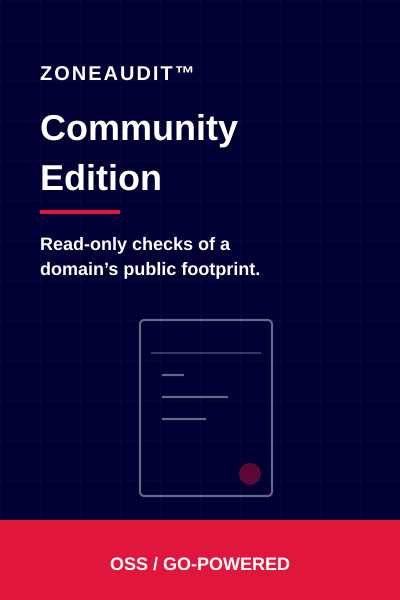
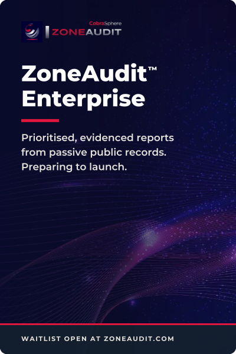
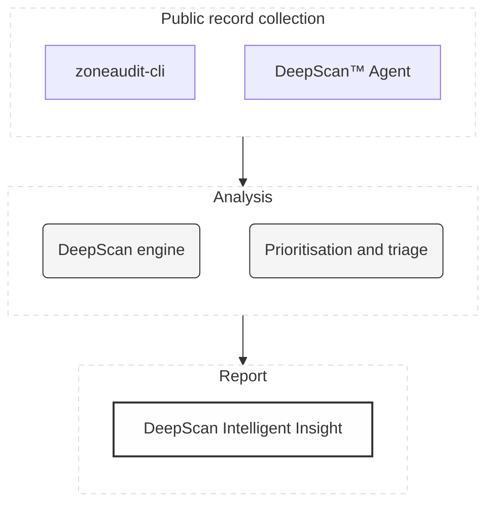

# ZoneAudit™

**Domain and attack surface intelligence from public records.**

ZoneAudit reads a domain's public records, such as DNS, certificates and registration data, and turns them into findings an organisation can act on. The open source Community Edition CLI is available now. ZoneAudit Enterprise is preparing to launch.

---

### Ecosystem and core projects

<table>
  <tr>
    <td width="45%" valign="top">
       
       
      <b>ZoneAudit Community Edition</b> 
      Read-only checks of a domain's public footprint, written in Go and open source. 
       
      <a href="https://github.com/ZoneAudit/zoneaudit-cli"><b>Explore the CLI →</b></a>
    </td>
    <td width="10%"></td>
    <td width="45%" valign="top">
       
       
      <b>ZoneAudit Enterprise</b> 
      Prioritised, evidenced reports from passive public records, with no probing. Preparing to launch. 
       
      <a href="https://zoneaudit.com/en-gb/access"><b>Request access →</b></a>
    </td>
  </tr>
</table>

---

### Data to insight flow

The Enterprise analysis and report stages are in development.

---

### Open source and community

The ZoneAudit Community Edition CLI is open source under the MIT licence. Anyone can run it against a domain they own or are authorised to assess.

- **Contribute.** Pull requests for the [zoneaudit-cli](https://github.com/ZoneAudit/zoneaudit-cli) are open, especially for new checks and performance improvements.
- **Checks.** New ways to spot orphaned infrastructure and misconfigured records are welcome.
- **Feedback.** Open an issue to discuss design improvements or feature requests.

---

### Connect with us

- **Website.** [zoneaudit.com](https://zoneaudit.com)
- **LinkedIn.** [ZoneAudit on LinkedIn](https://www.linkedin.com/company/zoneaudit)
- **Engineering.** Built by [CobraSphere](https://github.com/CobraSphere).

---

_Made in the United Kingdom._
